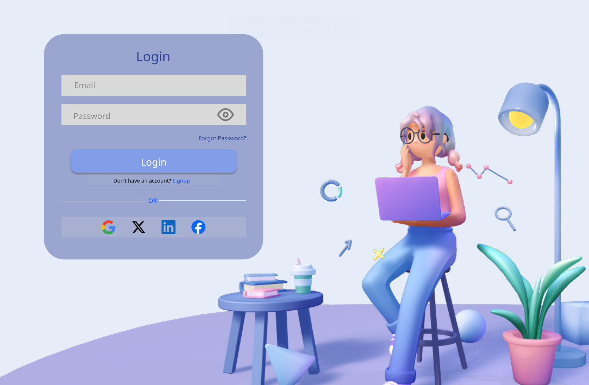
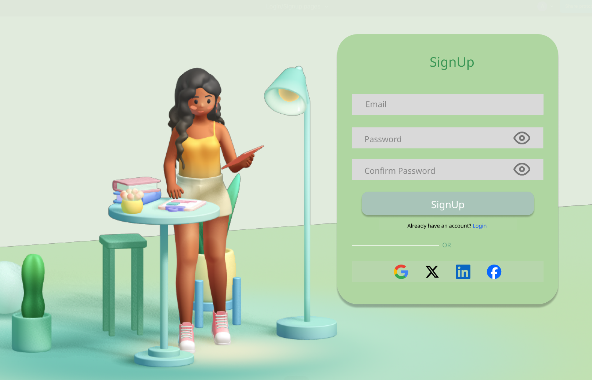
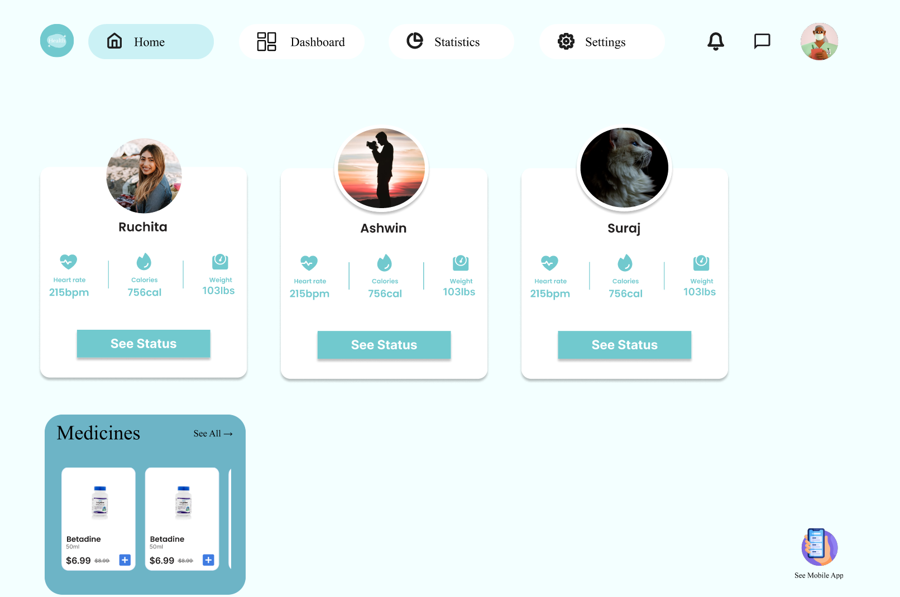
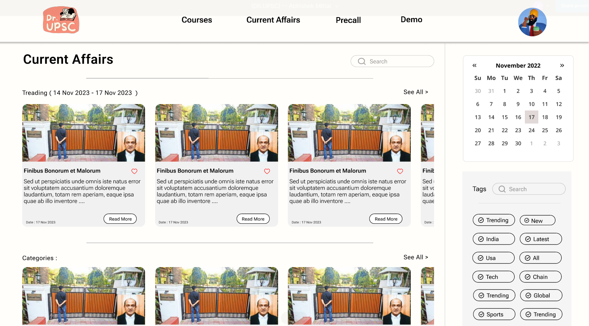
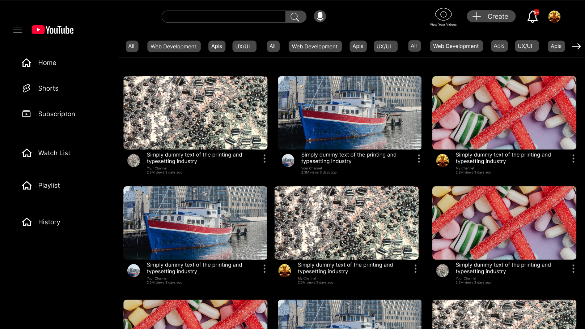

# UI/UX Designs Collection 🎨

This repository showcases a collection of UI designs created by me using **Figma**.  
The designs include mobile and web apps for health care, login/signup flows, a current affairs app, and a YouTube-style video platform.

Each project highlights **strong UX principles**, **navigation flows**, and **interactive elements**.

---

## 📱 Projects

### 1. Login / Signup Pages
- **Figma Link:** [View Login/Signup Pages](https://www.figma.com/proto/ICaFkPqdTm7vJLWRFyTUWX/Login-Signup-pages?node-id=1-2&p=f&t=mnxA2l66hd11gflF-0)
- **Screenshot:**  
  
  

**Features:**
- Switch seamlessly between **Login** and **Signup** screens.
- Simple and clean user flow for new user onboarding.
- Designed for a smooth mobile-first experience.

---

### 2. Health Care App (Mobile Version)
- **Figma Link:** [View Health Care Mobile App](https://www.figma.com/proto/Yi9u51geVvaH1KoAJzGWTE/Health-App?node-id=55-263&t=mnxA2l66hd11gflF-0)
- **Screenshot:**  
  

**Features:**
- User-centric mobile design for a health management app.
- **Switch between key screens** using intuitive bottom navigation.
- Access **family member profiles** for monitoring multiple health profiles.
- Smooth UX transitions to improve engagement.

---

### 3. Current Affairs App
- **Figma Link:** [View Current Affairs App](https://www.figma.com/proto/k2kqHILznbcDsqRYcpSxBo/-DR.UPSC-----Abhishek-MIttal?node-id=5-2&p=f&t=mnxA2l66hd11gflF-0)
- **Screenshot:**  
  

**Features:**
- Home page designed to present **current affairs** in a clean, organized layout.
- Quick navigation between topics.
- UX optimized for daily reading and quick browsing experience.

---

### 4. YouTube UI Concept (Korangle)
- **Figma Link:** [View YouTube UI](https://www.figma.com/proto/HHgHy488eZ6Yt84ZJas1og/Korangle---Abhishek-Mittal?t=mnxA2l66hd11gflF-0)
- **Screenshot:**  
  

**Features:**
- Redesigned YouTube-style interface.
- Click on the **"eye" button** to **highlight** specific videos (with red mark).
- Enhanced video browsing with easy-to-use visual cues.

---

## ✨ How to Explore
- **Click on the Figma links** above to view live interactive prototypes.
- **View screenshots** for a quick visual overview inside the repository folders.
- **Navigate through different UI flows** to understand the user journey.

---

## About Me
I'm passionate about designing clean, modern, and user-friendly interfaces.  
This collection highlights my commitment to **user experience (UX)** and **visual design excellence**.

---

> Thank you for visiting! Feel free to star ⭐ the repository if you liked the work.
